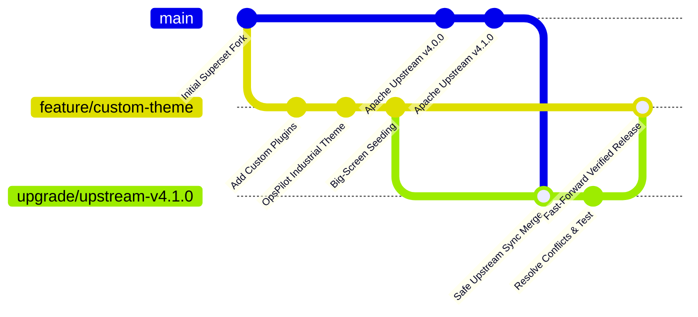

# OpsPilot (Custom Apache Superset)
## Enterprise Server Deployment & Upstream Upgrade Manual

**Document Version:** 2.0  
**Target Audience:** DevOps Engineers, System Administrators, IT Operations Leads  
**Scope:** Brand-new server provisioning, routine feature deployments, and upstream Apache Superset version synchronization.

---

## 📑 Table of Contents

1. [Platform Architecture & Core Concepts](#1-platform-architecture--core-concepts)
2. [Hardware, Software & Network Prerequisites](#2-hardware-software--network-prerequisites)
3. [Phase 1: Brand-New Server Deployment (First-Time Setup)](#3-phase-1-brand-new-server-deployment-first-time-setup)
   - [3.1: Repository Retrieval & Branch Selection](#step-31-repository-retrieval--branch-selection)
   - [3.2: Environment & Security Configuration](#step-32-environment--security-configuration)
   - [3.3: Launching Application Containers](#step-33-launching-application-containers)
   - [3.4: Database Initialization & Admin User Setup](#step-34-database-initialization--admin-user-setup)
   - [3.5: Automated Industrial Dashboard Seeding](#step-35-automated-industrial-dashboard-seeding)
   - [3.6: Verification & Access URLs](#step-36-verification--access-urls)
4. [Phase 2: Deploying OpsPilot Updates & Custom Bug Fixes](#4-phase-2-deploying-opspilot-updates--custom-bug-fixes)
   - [4.1: Pulling Code Updates](#step-41-pulling-code-updates)
   - [4.2: Restarting Services](#step-42-restarting-services)
   - [4.3: Crucial Client Browser Cache Invalidation](#step-43-crucial-client-browser-cache-invalidation)
5. [Phase 3: Upgrading Superset to Upstream Official Releases](#5-phase-3-upgrading-superset-to-upstream-official-releases)
   - [5.1: The Customization & Fork Architecture](#51-the-customization--fork-architecture)
   - [5.2: Remote Repository Setup (One-Time)](#step-52-remote-repository-setup-one-time)
   - [5.3: Mandatory Pre-Upgrade Database Backup](#step-53-mandatory-pre-upgrade-database-backup)
   - [5.4: Creating an Isolated Upgrade Branch](#step-54-creating-an-isolated-upgrade-branch)
   - [5.5: Merging an Official Upstream Release](#step-55-merging-an-official-upstream-release)
   - [5.6: Merge Conflict Resolution Matrix](#step-56-merge-conflict-resolution-matrix)
   - [5.7: Frontend Asset Compilation](#step-57-frontend-asset-compilation)
   - [5.8: Database Schema Migrations](#step-58-database-schema-migrations)
   - [5.9: Validation & Rollback Protocol](#step-59-validation--rollback-protocol)
6. [Phase 4: Day-to-Day Operations & Service Management](#6-phase-4-day-to-day-operations--service-management)
   - [6.1: Service Control (Start, Stop, Restart)](#61-service-control-start-stop-restart)
   - [6.2: Log Inspection](#62-log-inspection)
   - [6.3: Automated Daily Database Backups](#63-automated-daily-database-backups)
   - [6.4: Full Database Recovery](#64-full-database-recovery)
7. [Phase 5: Production Hardening, HTTPS & TV Kiosk Mode](#7-phase-5-production-hardening-https--tv-kiosk-mode)
   - [7.1: Nginx SSL / TLS Setup](#71-nginx-ssl--tls-setup)
   - [7.2: Dedicated 24/7 TV Display Kiosk Setup](#72-dedicated-247-tv-display-kiosk-setup)
8. [Phase 6: Troubleshooting Matrix & Operational FAQ](#8-phase-6-troubleshooting-matrix--operational-faq)

---

## 1. Platform Architecture & Core Concepts

OpsPilot is an enterprise industrial visualization platform built on top of **Apache Superset**. It features customized high-contrast dark themes, custom plant-floor widgets (Bulk Loading, Elevator Status, Warehouse Replenishment, Tote Farms, Small Pours), and automated database seeding.

### Component Architecture

```
                    ┌────────────────────────────────────────────────────────┐
                    │                   End-User / TV Displays               │
                    └───────────────────────────┬────────────────────────────┘
                                                │
                                       HTTP / HTTPS (Port 80 / 443)
                                                ▼
┌────────────────────────────────────────────────────────────────────────────────────────┐
│                                   NGINX REVERSE PROXY                                  │
│                       (Static Asset Serving + API Request Routing)                     │
└───────────────┬───────────────────────────────┬───────────────────────────────┬────────┘
                │                               │                               │
        Port 8088 (REST API/Web)        Port 8080 (Live Events)             Static Cache
                ▼                               ▼                               ▼
┌───────────────────────────────┐ ┌───────────────────────────┐ ┌────────────────────────┐
│     SUPERSET APP CONTAINER    │ │ SUPERSET WEBSOCKET SERVER │ │    BROWSER DISK CACHE  │
│   - Gunicorn Web Server       │ │ - Async live UI push      │ │ - 1-year max-age       │
│   - Flask Backend Engine      │ │ - Redis Pub/Sub events    │ │ - Chunk versioning     │
│   - Custom Plugin Registry    │ └─────────────┬─────────────┘ └────────────────────────┘
└───────────────┬───────────────┘               │
                │                               │
                ▼                               ▼
┌───────────────────────────────┐ ┌───────────────────────────┐
│     CELERY ASYNC WORKERS      │ │        REDIS CACHE        │
│   - superset-worker           │ │ - Query result caching    │
│   - superset-worker-beat      │ │ - Session tokens          │
└───────────────┬───────────────┘ └─────────────┬─────────────┘
                │                               │
                └───────────────┬───────────────┘
                                ▼
┌─────────────────────────────────────────────────────────────┐
│                 POSTGRESQL 16 DATABASE                      │
│   - superset (Metadata, Users, Dashboards, Permissions)     │
│   - examples (Plant Data: Bulk Loading, Totes, Elevators)   │
└─────────────────────────────────────────────────────────────┘
```

---

## 2. Hardware, Software & Network Prerequisites

### Hardware Sizing

| Component | Minimum (Staging / Lab) | Recommended (Production / Multi-Screen TV) |
|---|---|---|
| **CPU** | 4 Physical Cores | 8+ Cores (Intel Xeon / AMD EPYC / Modern x86_64) |
| **RAM** | 8 GB | 16 GB – 32 GB |
| **Storage** | 30 GB SSD | 80+ GB Enterprise NVMe SSD |
| **Network** | 100 Mbps LAN | 1 Gbps LAN |

### Software Prerequisites

1. **Host Operating System:**  
   - Ubuntu 22.04 LTS / 24.04 LTS (Recommended)
   - Debian 11 / 12
   - RHEL / Rocky Linux / AlmaLinux 8 / 9
   - Windows Server 2022 (with WSL2 & Docker Engine)
2. **Docker Engine:** `v24.0+` ([Official Installation Guide](https://docs.docker.com/engine/install/))
3. **Docker Compose:** Plugin `v2.20+` (`docker compose version`)
4. **Git:** `v2.30+` (`git --version`)

### Network Firewall Rules (Inbound)

| Port | Protocol | Purpose | Access Scope |
|---|---|---|---|
| **80** | TCP | HTTP (Nginx Web Proxy) | Plant-Floor Network / Users |
| **443** | TCP | HTTPS (SSL Encrypted Web Traffic) | Plant-Floor Network / Users |
| **8088** | TCP | Superset Direct Backend (Optional / Internal) | Administrative LAN |
| **8080** | TCP | WebSocket Live Dashboard Streaming | Plant-Floor Network / Users |
| **5432** | TCP | PostgreSQL Database | Bound to `127.0.0.1` (Internal Only) |
| **6379** | TCP | Redis Cache | Bound to `127.0.0.1` (Internal Only) |

---

## 3. Phase 1: Brand-New Server Deployment (First-Time Setup)

Follow this exact step-by-step procedure when setting up OpsPilot on a clean server.

### Step 3.1: Repository Retrieval & Branch Selection

Log into the server terminal via SSH and clone the official customized repository:

```bash
# 1. Clone the customized OpsPilot repository
git clone https://github.com/pran786/Opspilot.git

# 2. Navigate into the repository directory
cd Opspilot

# 3. Checkout the active customized production branch
git checkout feature/custom-theme

# 4. Verify branch and latest commit
git status
git log -n 1 --oneline
```

---

### Step 3.2: Environment & Security Configuration

Create the server environment configuration files from the templates:

```bash
# 1. Copy the local environment override template
cp -n docker/.env-local.example docker/.env-local 2>/dev/null || touch docker/.env-local

# 2. Verify base configuration exists
ls -l docker/.env
```

#### Production Security Hardening

Generate a cryptographically secure random secret key and apply it to `docker/.env`:

```bash
# Generate a 42-character secure secret key
SECRET=$(openssl rand -base64 42)

# Update SUPERSET_SECRET_KEY in docker/.env (Linux)
sed -i "s|^SUPERSET_SECRET_KEY=.*|SUPERSET_SECRET_KEY=${SECRET}|" docker/.env

# Or manually verify docker/.env contains:
grep "SUPERSET_SECRET_KEY" docker/.env
```

> [!IMPORTANT]
> Never leave `SUPERSET_SECRET_KEY` set to the default value. If you lose or change this key later, all encrypted database connection passwords stored in Superset will become unreadable. Keep a secure backup of this key.

---

### Step 3.3: Launching Application Containers

OpsPilot provides two Docker Compose configurations:
- **`docker-compose-fast.yml` (Recommended)**: Optimized for fast startups and live volume mounting. Uses pre-built images.
- **`docker-compose.yml`**: Standard full stack.

Execute the following to build and launch using the Fast stack:

```bash
# 1. Build the local images
docker compose -f docker-compose-fast.yml build

# 2. Start the entire container stack in detached (background) mode
docker compose -f docker-compose-fast.yml up -d

# 3. Verify all containers are running and healthy
docker compose -f docker-compose-fast.yml ps
```

**Expected healthy containers:**
- `opspilot-superset-1` (Backend API / Web Server)
- `opspilot-nginx-1` (Web Proxy on Port 80)
- `opspilot-db-1` (PostgreSQL 16)
- `opspilot-redis-1` (Redis 7)
- `opspilot-superset-worker-1` (Celery Worker)
- `opspilot-superset-worker-beat-1` (Celery Beat Scheduler)
- `opspilot-superset-websocket-1` (WebSocket Server on Port 8080)

---

### Step 3.4: Database Initialization & Admin User Setup

Once the database container is online, initialize the Superset metadata schema and create the primary administrator:

```bash
# 1. Run database schema migrations
docker compose -f docker-compose-fast.yml exec -T superset superset db upgrade

# 2. Create the system Administrator account
# (Replace 'admin' and 'YourSecurePassword123!' with your desired credentials)
docker compose -f docker-compose-fast.yml exec -T superset superset fab create-admin \
    --username admin \
    --firstname OpsPilot \
    --lastname Admin \
    --email admin@opspilot.local \
    --password YourSecurePassword123!

# 3. Initialize default roles and permissions
docker compose -f docker-compose-fast.yml exec -T superset superset init
```

---

### Step 3.5: Automated Industrial Dashboard Seeding

OpsPilot includes an automated master seeder that configures the PostgreSQL `examples` dataset database, builds simulated industrial plant tables, and publishes the 4 production dashboards.

Run the seeder directly inside the backend container:

```bash
docker compose -f docker-compose-fast.yml exec -T superset python scripts/seed_all_opspilot_dashboards.py
```

**Execution Log Output Example:**
```text
==========================================================
 OpsPilot Master Big-Screen Dashboard Seeder
==========================================================
>>> Preflight check: Ensuring PostgreSQL 'examples' user and database exist...
>>> PostgreSQL 'examples' user & database ready.
>>> Running: seed_receiving_dashboard.py ...
>>> Running: seed_wh_replenishment_dashboard.py ...
>>> Running: seed_totefarm_dashboard.py ...
>>> Running: seed_small_pours_dashboard.py ...
>>> Post-seeding: Ensuring dashboard ownership and database permissions...
>>> Ensured admin ownership for 4 OpsPilot dashboards.
>>> Granted database access on [examples] to 'Gamma' role.
>>> Granted database access on [examples] to 'Public' role.
==========================================================
 All OpsPilot Dashboards Seeded Successfully!
==========================================================
```

---

### Step 3.6: Verification & Access URLs

Open your browser and navigate to the server using its IP address or configured domain name:

| Interface | URL | Description |
|---|---|---|
| **Standard User Portal** | `http://<SERVER_IP>/opspilot/welcome/` | Login screen and dashboard catalogue (via Nginx Port 80) |
| **Direct Backend Port** | `http://<SERVER_IP>:8088/opspilot/welcome/` | Direct Flask/Gunicorn backend |
| **1-Receiving (TV Kiosk)** | `http://<SERVER_IP>/opspilot/dashboard/1-receiving/?standalone=3` | Truck loading chevrons & receiving schedule |
| **2-WH Replenishment (TV Kiosk)**| `http://<SERVER_IP>/opspilot/dashboard/2-wh-replenishment/?standalone=3` | Bay matrix, elevator statuses, forklift queues |
| **3-ToteFarm (TV Kiosk)** | `http://<SERVER_IP>/opspilot/dashboard/3-totefarm/?standalone=3` | Tote farm metrics, flow rates, status cards |
| **5-Small Pours (TV Kiosk)** | `http://<SERVER_IP>/opspilot/dashboard/5-small-pours/?standalone=3` | Small pours batch queues, operators, timers |

> [!TIP]
> Adding `?standalone=3` to any dashboard URL strips all navigation headers, sidebars, and edit buttons. It delivers a 100% fullscreen, high-contrast display designed specifically for plant-floor TV monitors.

---

## 4. Phase 2: Deploying OpsPilot Updates & Custom Bug Fixes

When the development team releases custom UI updates, new charts, or bug fixes to GitHub, apply them to the production server with zero downtime.

### Step 4.1: Pulling Code Updates

```bash
# 1. Switch to the Opspilot deployment folder
cd ~/Opspilot

# 2. Discard any local accidental edits (if applicable) and pull latest commits
git fetch origin feature/custom-theme
git pull origin feature/custom-theme

# 3. Check that the commit hash matches the expected release
git log -n 1 --oneline
```

---

### Step 4.2: Restarting Services

```bash
# 1. Restart Superset backend and Nginx to pick up new bundles
docker compose -f docker-compose-fast.yml restart superset nginx

# 2. Run database migrations (in case new schema tables or columns were added)
docker compose -f docker-compose-fast.yml exec -T superset superset db upgrade

# 3. (Optional) Re-run seeder if chart dataset queries or card designs were modified
docker compose -f docker-compose-fast.yml exec -T superset python scripts/seed_all_opspilot_dashboards.py
```

---

### Step 4.3: Crucial Client Browser Cache Invalidation

Superset static web assets (`.chunk.js`, `.css`) are served with HTTP header `Cache-Control: public, max-age=31536000` (1 full year) for maximum performance.

When an updated chunk is deployed:
1. Standard refresh (`F5`) **will not** reload dynamically loaded chart components because modern browsers read them from local disk cache.
2. **To see changes immediately:**
   - **Windows / Linux:** Press **`Ctrl + Shift + R`** (or `Ctrl + F5`).
   - **macOS:** Press **`Cmd + Shift + R`**.
   - **Incognito Test:** Open the dashboard in an Incognito / InPrivate browser window (`Ctrl + Shift + N`).
   - **Developer Tools:** Press `F12`, right-click the Refresh icon in the browser URL bar, and select **"Empty Cache and Hard Reload"**.

---

## 5. Phase 3: Upgrading Superset to Upstream Official Releases

OpsPilot is a downstream customized fork of official [Apache Superset](https://github.com/apache/superset). To incorporate official security patches, performance enhancements, and new database connectors from Apache without overwriting OpsPilot customizations, follow this structured upgrade protocol.

### 5.1: The Customization & Fork Architecture



---

### Step 5.2: Remote Repository Setup (One-Time)

Verify your Git remote endpoints. Run on the build/deployment machine:

```bash
git remote -v
```

If only `origin` is listed, add the official Apache Superset upstream repository:

```bash
# Add official Apache Superset as the 'upstream' remote
git remote add upstream https://github.com/apache/superset.git

# Verify both remotes are configured
git remote -v
# Expected:
# origin    https://github.com/pran786/Opspilot.git (fetch & push)
# upstream  https://github.com/apache/superset.git (fetch & push)
```

---

### Step 5.3: Mandatory Pre-Upgrade Database Backup

**NEVER perform an upstream upgrade without a verified database backup.**

```bash
# Create a timestamped backup directory
mkdir -p ~/opspilot_backups

# Dump the complete PostgreSQL metadata database
docker compose -f docker-compose-fast.yml exec -T db pg_dump -U superset superset > ~/opspilot_backups/superset_backup_pre_upgrade_$(date +%Y%m%d_%H%M%S).sql

# Dump the industrial plant examples database
docker compose -f docker-compose-fast.yml exec -T db pg_dump -U examples examples > ~/opspilot_backups/examples_backup_pre_upgrade_$(date +%Y%m%d_%H%M%S).sql

# Verify backup files exist and have non-zero size
ls -lh ~/opspilot_backups/
```

---

### Step 5.4: Creating an Isolated Upgrade Branch

Never merge upstream updates directly into `feature/custom-theme`. Always perform the upgrade in an isolated branch:

```bash
# 1. Fetch latest upstream releases and tags
git fetch upstream --tags
git fetch upstream master

# 2. Checkout our current working custom branch
git checkout feature/custom-theme
git pull origin feature/custom-theme

# 3. Create a new upgrade branch (e.g. for official version 4.1.1)
git checkout -b upgrade/upstream-$(date +%Y%m%d)
```

---

### Step 5.5: Merging an Official Upstream Release

Choose **Option A** for the latest stable release tag (Recommended for enterprise) or **Option B** for development bleeding-edge master:

```bash
# Option A: Merge a specific verified release tag (Recommended)
git merge tags/4.1.1 -m "chore(upgrade): merge official Apache Superset v4.1.1"

# Option B: Merge latest upstream master
# git merge upstream/master -m "chore(upgrade): merge official upstream master"
```

---

### Step 5.6: Merge Conflict Resolution Matrix

If Git flags merge conflicts, follow this strict protection matrix to preserve OpsPilot features:

| File / Folder | Action | Reason |
|---|---|---|
| `superset-frontend/plugins/plugin-chart-*` | **KEEP OURS (`feature/custom-theme`)** | Contains our proprietary cards: `bulk-loading-card`, `elevator-status`, `kpi-dual-column-card`, `parking-spot-matrix`, `unified-list-bar`, `unified-list-arrow`, `dashboard-utility-bar`, `custom-gauge`. |
| `scripts/seed_*.py` | **KEEP OURS** | Proprietary automated plant dashboard seeders. |
| `docker-compose-fast.yml` & `docker-compose.yml` | **KEEP OURS** | Customized port bindings, volume mounts, and service definitions. |
| `docker/docker-init.sh` & `docker-bootstrap.sh` | **KEEP OURS** | Contains initialization scripts and automated database preflight commands. |
| `superset-frontend/src/visualizations/presets/MainPreset.ts` | **MERGE CAREFULLY** | Retain custom plugin imports (`BulkLoadingCardChartPlugin`, etc.) inside the plugin array while accepting upstream additions. |
| `superset/config.py` & `superset_config.py` | **MERGE CAREFULLY** | Retain our custom dark branding, logo paths, and feature flags while accepting new upstream configuration keys. |
| `superset/static/assets/` | **REBUILD / KEEP TRACKED CHUNKS** | Rebuild or keep our tracked custom chart chunks. |

Once conflicts are resolved:
```bash
# Stage resolved files
git add .

# Finalize the merge commit
git commit -m "chore(upgrade): resolved merge conflicts for OpsPilot custom modules"
```

---

### Step 5.7: Frontend Asset Compilation

If upstream changes included modifications to core frontend dependencies or libraries, rebuild the frontend bundle:

```bash
# Method 1: Using Node on the host (Fastest if Node.js 18+ is installed)
cd superset-frontend
npm install --prefer-online
npm run build
cd ..

# Method 2: Using a one-off Docker container (No host Node.js required)
docker run --rm \
  -v $(pwd)/superset-frontend:/app/superset-frontend \
  -v $(pwd)/superset/static/assets:/app/superset/static/assets \
  -w /app/superset-frontend \
  node:18-alpine sh -c "npm install && npm run build"
```

---

### Step 5.8: Database Schema Migrations

Apply any newly introduced official Alembic schema migrations:

```bash
# 1. Rebuild and launch the upgraded containers
docker compose -f docker-compose-fast.yml up -d --build

# 2. Execute schema migration
docker compose -f docker-compose-fast.yml exec -T superset superset db upgrade

# 3. Refresh permission roles
docker compose -f docker-compose-fast.yml exec -T superset superset init

# 4. Re-seed OpsPilot dashboards to ensure query structures align
docker compose -f docker-compose-fast.yml exec -T superset python scripts/seed_all_opspilot_dashboards.py
```

---

### Step 5.9: Validation & Rollback Protocol

#### Quality Assurance Checklist
- [ ] Log in with Admin credentials at `http://<SERVER_IP>/opspilot/welcome/`
- [ ] Open `1-Receiving` (`/opspilot/dashboard/1-receiving/?standalone=3`): Check truck graphics and single status chevrons
- [ ] Open `2-WH Replenishment`: Check bay occupancy matrix and elevator animations
- [ ] Open `3-ToteFarm`: Check tote cards and line flow metrics
- [ ] Open `5-Small Pours`: Check batch timers and status countdowns
- [ ] Test creating a simple test chart in SQL Lab

#### Rollback Procedure (In Case Upstream Has Critical Bugs)
If the upstream version fails validation, roll back to the pre-upgrade state in 3 minutes:

```bash
# 1. Tear down upgraded containers
docker compose -f docker-compose-fast.yml down

# 2. Switch back to the stable branch
git checkout feature/custom-theme

# 3. Restart stable containers
docker compose -f docker-compose-fast.yml up -d

# 4. Restore the database from the pre-upgrade backup
docker compose -f docker-compose-fast.yml exec -T db dropdb -U superset superset
docker compose -f docker-compose-fast.yml exec -T db createdb -U superset superset
docker compose -f docker-compose-fast.yml exec -T db psql -U superset superset < ~/opspilot_backups/superset_backup_pre_upgrade_*.sql
```

#### Promoting the Verified Upgrade
When the upgrade passes all validation tests:

```bash
# Switch to production branch
git checkout feature/custom-theme

# Merge the validated upgrade branch
git merge upgrade/upstream-$(date +%Y%m%d)

# Push the upgraded release to GitHub
git push origin feature/custom-theme
```

---

## 6. Day-to-Day Operations & Service Management

### 6.1: Service Control (Start, Stop, Restart)

```bash
# Check status of all OpsPilot services
docker compose -f docker-compose-fast.yml ps

# Gracefully restart all services
docker compose -f docker-compose-fast.yml restart

# Restart Superset backend worker only
docker compose -f docker-compose-fast.yml restart superset

# Restart Nginx web server only
docker compose -f docker-compose-fast.yml restart nginx

# Stop all services without deleting any database data
docker compose -f docker-compose-fast.yml stop

# Start previously stopped services
docker compose -f docker-compose-fast.yml start

# Full teardown of containers (volumes and data remain completely safe)
docker compose -f docker-compose-fast.yml down
```

---

### 6.2: Log Inspection

```bash
# Stream live logs for all services combined
docker compose -f docker-compose-fast.yml logs -f

# Stream backend API & Gunicorn logs
docker compose -f docker-compose-fast.yml logs -f superset

# Stream Nginx web server access & error logs
docker compose -f docker-compose-fast.yml logs -f nginx

# Stream Celery async worker logs
docker compose -f docker-compose-fast.yml logs -f superset-worker

# Inspect last 100 log lines of PostgreSQL
docker compose -f docker-compose-fast.yml logs --tail=100 db
```

---

### 6.3: Automated Daily Database Backups

Set up an automated nightly cron backup job on the server:

```bash
# 1. Create backup directory
mkdir -p /opt/opspilot_backups

# 2. Create the backup script: /opt/opspilot_backup.sh
cat << 'EOF' > /opt/opspilot_backup.sh
#!/bin/bash
BACKUP_DIR="/opt/opspilot_backups"
TIMESTAMP=$(date +%Y%m%d_%H%M%S)
PROJECT_DIR="$HOME/Opspilot"

# Run pg_dump inside the container
cd $PROJECT_DIR
docker compose -f docker-compose-fast.yml exec -T db pg_dump -U superset superset | gzip > "$BACKUP_DIR/superset_backup_$TIMESTAMP.sql.gz"
docker compose -f docker-compose-fast.yml exec -T db pg_dump -U examples examples | gzip > "$BACKUP_DIR/examples_backup_$TIMESTAMP.sql.gz"

# Retain backups for 30 days, delete older
find "$BACKUP_DIR" -type f -name "*.sql.gz" -mtime +30 -delete
EOF

# 3. Grant execute permissions
chmod +x /opt/opspilot_backup.sh

# 4. Schedule nightly at 02:00 AM in crontab
(crontab -l 2>/dev/null; echo "0 2 * * * /opt/opspilot_backup.sh >> /var/log/opspilot_backup.log 2>&1") | crontab -
```

---

### 6.4: Full Database Recovery

To restore from a backup `.sql.gz` file:

```bash
# 1. Unpack backup
gunzip -k /opt/opspilot_backups/superset_backup_YYYYMMDD_HHMMSS.sql.gz

# 2. Terminate active connections and recreate database
docker compose -f docker-compose-fast.yml exec -T db psql -U superset -c "SELECT pg_terminate_backend(pid) FROM pg_stat_activity WHERE datname = 'superset' AND pid <> pg_backend_pid();"
docker compose -f docker-compose-fast.yml exec -T db dropdb -U superset superset
docker compose -f docker-compose-fast.yml exec -T db createdb -U superset superset

# 3. Stream SQL data back into database
docker compose -f docker-compose-fast.yml exec -T db psql -U superset superset < /opt/opspilot_backups/superset_backup_YYYYMMDD_HHMMSS.sql

# 4. Restart backend
docker compose -f docker-compose-fast.yml restart superset
```

---

## 7. Phase 5: Production Hardening, HTTPS & TV Kiosk Mode

### 7.1: Nginx SSL / TLS Setup

To serve OpsPilot securely over `https://` with custom SSL certificates:

1. Copy your SSL certificate and private key to the server:
   - `/etc/ssl/certs/opspilot.crt`
   - `/etc/ssl/private/opspilot.key`

2. Edit `docker/nginx/nginx.conf` or mount certificates in `docker-compose-fast.yml`:
   ```yaml
   nginx:
     volumes:
       - ./docker/nginx/nginx.conf:/etc/nginx/nginx.conf:ro
       - /etc/ssl/certs/opspilot.crt:/etc/nginx/certs/opspilot.crt:ro
       - /etc/ssl/private/opspilot.key:/etc/nginx/certs/opspilot.key:ro
     ports:
       - "80:80"
       - "443:443"
   ```

3. Enable HTTPS server block in `docker/nginx/templates/superset.conf.template`:
   ```nginx
   server {
       listen 443 ssl http2;
       server_name opspilot.company.com;

       ssl_certificate     /etc/nginx/certs/opspilot.crt;
       ssl_certificate_key /etc/nginx/certs/opspilot.key;
       ssl_protocols       TLSv1.2 TLSv1.3;
       ssl_ciphers         HIGH:!aNULL:!MD5;

       location / {
           proxy_pass http://superset:8088;
           proxy_set_header Host $host;
           proxy_set_header X-Forwarded-Proto https;
           proxy_set_header X-Real-IP $remote_addr;
           proxy_set_header X-Forwarded-For $proxy_add_x_forwarded_for;
       }
   }
   ```

---

### 7.2: Dedicated 24/7 TV Display Kiosk Setup

For wall-mounted TV monitors (e.g., Raspberry Pi, Mini PC, Intel NUC, or Smart TV box running Ubuntu/Debian):

#### Automatic Fullscreen Chromium Kiosk Script
Create `/home/display/start_kiosk.sh`:

```bash
#!/bin/bash
# Disable screensaver and power management
xset s off
xset -dpms
xset s noblank

# Target Dashboard URL in Kiosk Mode (Strip all menus)
DASHBOARD_URL="http://192.168.1.127/opspilot/dashboard/1-receiving/?standalone=3"

# Kill existing instances
killall chromium-browser 2>/dev/null || killall chrome 2>/dev/null

# Launch Chromium in dedicated kiosk mode
chromium-browser \
  --noerrdialogs \
  --disable-infobars \
  --kiosk \
  --incognito \
  --check-for-update-interval=31536000 \
  --disable-pinch \
  --overscroll-history-navigation=0 \
  "$DASHBOARD_URL"
```

Make it executable and auto-start on desktop login:
```bash
chmod +x /home/display/start_kiosk.sh
echo "@/home/display/start_kiosk.sh" >> ~/.config/lxsession/LXDE-pi/autostart
```

---

## 8. Phase 6: Troubleshooting Matrix & Operational FAQ

| # | Symptom / Error | Probable Cause | Immediate Remediation |
|---|---|---|---|
| **1** | Dashboard still shows old chart layout after `git pull`. | Client browser or service worker disk cache (`max-age=31536000`). | Press **`Ctrl + Shift + R`** (or `Cmd + Shift + R`). Test in an Incognito tab (`Ctrl + Shift + N`). |
| **2** | `Invalid login credentials` on first login. | Admin account was not initialized in the database. | Run: `docker compose -f docker-compose-fast.yml exec -T superset superset fab create-admin` followed by `superset init`. |
| **3** | `Port 80 or 8088 is already in use`. | Another web server (Apache/IIS/local Nginx) occupies port 80/8088. | In `docker/.env-local`, set `NGINX_PORT=8085` and `SUPERSET_PORT=8089`. Run `docker compose -f docker-compose-fast.yml up -d`. |
| **4** | `Pending database migrations` / Alembic errors. | Upstream update introduced new schema tables. | Run: `docker compose -f docker-compose-fast.yml exec -T superset superset db upgrade`. |
| **5** | Charts show `No Active Bulk Loading Operations` or blank. | Industrial seed dataset has not been loaded into PostgreSQL. | Run: `docker compose -f docker-compose-fast.yml exec -T superset python scripts/seed_all_opspilot_dashboards.py`. |
| **6** | TV screen shows `Access Denied` / Login Prompt on kiosk. | Public role does not have read permissions for the dashboard. | Re-run `python scripts/seed_all_opspilot_dashboards.py`. It automatically grants read access on `[examples]` database to `Gamma` and `Public` roles. |
| **7** | Container exits with `Killed` or `Exit code 137`. | Out of memory (OOM). Docker allocated less than 6 GB RAM. | Increase Docker memory allocation in Docker Desktop / Host to at least 8 GB RAM. |

---

## 📞 Support Contacts & Documentation References

- **Internal Repository:** `https://github.com/pran786/Opspilot`
- **Active Production Branch:** `feature/custom-theme`
- **Upstream Official Repository:** `https://github.com/apache/superset`
- **Official Superset Documentation:** `https://superset.apache.org/docs/intro`
